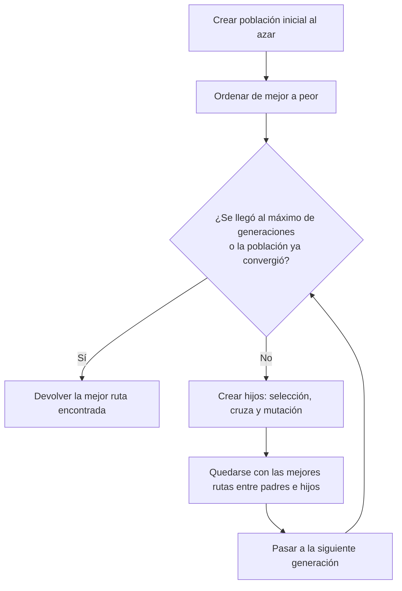

# TSP con Algoritmo Genético

## Definición del problema

Este proyecto consiste en desarrollar un **algoritmo genético (AG)** que resuelva un **Problema del Viajante (TSP)** dada una **matriz de 20×20**.

El usuario puede elegir:

- El **estado inicial**, es decir, el punto de donde sale la ruta y al que debe regresar.
- El **número de nodos** que se deben visitar.
- La **ubicación** de cada uno de los nodos en la matriz.

El objetivo es encontrar la **ruta más corta** que sale del inicio, visita todos los nodos una sola vez y regresa al inicio. El programa busca esa ruta con el algoritmo genético y la dibuja con flechas sobre la matriz.

> Como el algoritmo genético usa el azar, no garantiza encontrar la ruta más corta de todas, pero normalmente llega a una muy buena (ver [Resultado](#11-resultado)).

| Lo que elige el usuario | Cómo se hace en el programa |
|---|---|
| Estado inicial | Clic en una celda con la opción *Colocar inicio* (o se asigna al azar con *Nodos al azar*). |
| Número de nodos | Campo *Número de nodos* (de 1 a 50). |
| Ubicación de cada nodo | Clic en las celdas de la matriz (o *Nodos al azar* / *Cargar ejemplo*). |

---

## Contenido

1. [Definición del problema](#definición-del-problema)
2. [Estructura del proyecto](#estructura-del-proyecto)
3. [Descarga](#descarga)
4. [Cómo ejecutarlo](#cómo-ejecutarlo)
5. [Cómo se usa](#cómo-se-usa)
6. [Cómo funciona el algoritmo genético](#cómo-funciona-el-algoritmo-genético)
7. [Parámetros](#parámetros)
8. [Ejemplo incluido](#ejemplo-incluido)

---

## Estructura del proyecto

| Archivo | Qué hace |
|---|---|
| `Nodo.java` | Representa un punto de la matriz con su fila y su columna, y calcula la distancia en línea recta hacia otro punto. |
| `AlgoritmoGenetico.java` | Aquí está toda la lógica del algoritmo genético: crear rutas, evaluarlas, combinarlas, mutarlas y quedarse con las mejores. No sabe nada de la ventana ni del dibujo. |
| `PanelMatriz.java` | Dibuja la cuadrícula, el inicio, los nodos y la ruta encontrada. También guarda los nodos que vas colocando. |
| `VentanaTSP.java` | Es la ventana principal: tiene los botones y campos, atiende tus clics, ejecuta el algoritmo y muestra los resultados. Es el archivo con el que se inicia el programa. |

### Cómo se conectan

```
VentanaTSP ──usa──▶ PanelMatriz ──guarda──▶ Nodo (inicio y nodos)
    │
    └──ejecuta──▶ AlgoritmoGenetico ──usa──▶ Nodo
                        │
                        └── devuelve la mejor ruta ──▶ PanelMatriz (la dibuja)
```

Qué pasa al presionar **Resolver**:

1. La ventana revisa que haya un inicio y que la cantidad de nodos colocados coincida con la que elegiste.
2. Crea el algoritmo genético con el inicio, los nodos y los parámetros de la pantalla.
3. El algoritmo se ejecuta y devuelve la mejor ruta que encontró.
4. La ruta se dibuja en la matriz y los resultados aparecen en el panel de la derecha.

---

## Descarga

Clonar con Git:

```bash
git clone https://github.com/AngelDta33/Proyecto2-IA-FESAR.git
```

---

## Cómo ejecutarlo

Necesitas tener Java instalado (JDK 8 o superior). Desde la carpeta del proyecto:

```bash
java VentanaTSP
```

---

## Cómo se usa

1. **Colocar el inicio:** con la opción *Colocar inicio* seleccionada, haz clic en una celda de la matriz. Después de colocarlo, la opción cambia sola a *Colocar nodos*.
2. **Colocar los nodos:** haz clic en las celdas donde quieras los nodos. Se numeran en el orden en que los colocas (1, 2, 3, ...). No puedes poner dos cosas en la misma celda ni pasarte del número de nodos configurado.
3. **Atajos para armar el problema:**
   - **Nodos al azar:** coloca los nodos en celdas libres al azar (y el inicio, si todavía no lo pusiste).
   - **Cargar ejemplo:** carga el problema del enunciado (ver [Ejemplo incluido](#ejemplo-incluido)).
   - **Limpiar:** borra el inicio, los nodos y los resultados.
4. **Ajustar los parámetros** del algoritmo (ver [Parámetros](#parámetros)).
5. Presionar **Resolver**. La mejor ruta que encontró el algoritmo aparece dibujada con flechas y en el panel de resultados.

El panel de resultados muestra las coordenadas del inicio y de cada nodo, la solución (por ejemplo `2-7-3-1-6-4-5`), la distancia total, cuántas generaciones se usaron y cómo fue mejorando la ruta generación por generación.

---

## Cómo funciona el algoritmo genético

Un algoritmo genético imita la evolución: se parte de muchas rutas al azar, se combinan las mejores para crear rutas nuevas, a veces se les hace un cambio aleatorio, y se repite muchas veces hasta que las rutas dejan de mejorar.

### 1. Cómo se representa una ruta

Cada ruta (llamada **individuo**) es una lista con el **orden en que se visitan los nodos**, usando sus números del 1 al n. Por ejemplo, `[2, 7, 3, 1, 6, 4, 5]`.

El inicio **no** va en la lista: toda ruta sale del inicio, pasa por los nodos en ese orden y regresa al inicio. Así, toda ruta es válida: visita todos los nodos exactamente una vez.

### 2. Población inicial

Se crea un grupo de rutas (la **población**), cada una con los nodos en un orden completamente al azar.

### 3. Qué tan buena es una ruta (aptitud)

```
distancia total = inicio → primer nodo → ... → último nodo → inicio
aptitud         = 1 / distancia total
```

La distancia entre dos puntos es la **distancia en línea recta**. Mientras más corta es la ruta, mayor es su aptitud.

### 4. El ciclo principal



### 5. Creación de hijos

En cada generación se crean tantos hijos como individuos tiene la población. Se hace por parejas, y cada pareja de padres produce 2 hijos:

1. **Selección:** se eligen 2 padres usando la ruleta.
2. **Cruza:** con cierta probabilidad, los padres se combinan para formar 2 hijos. Si no se cruzan, los hijos son copias de los padres.
3. **Mutación:** cada hijo, por separado, puede sufrir una mutación con cierta probabilidad.

### 6. Selección por ruleta

Imagina una ruleta donde cada ruta ocupa un espacio proporcional a su aptitud. Se gira la ruleta y la ruta donde cae es la elegida. Las rutas más cortas tienen más espacio, así que se eligen más seguido, pero cualquier ruta tiene oportunidad.

### 7. Cruza PMX

PMX (*Partially Mapped Crossover*) combina dos rutas padre sin repetir ni perder nodos. Se eligen dos puntos de corte que marcan un tramo central. El hijo se arma así:

1. Recibe el **tramo central del padre B**.
2. El resto de las posiciones se llena con el **padre A**. Si algún nodo de A ya está en el tramo copiado (se repetiría), se cambia por el nodo que le corresponde en el otro padre, hasta encontrar uno que no se repita.

Ejemplo:

```
A = (1 2 3 | 4 5 6 | 7 8)
B = (3 7 5 | 1 6 8 | 2 4)

Hijo de A con B = (4 2 3 1 6 8 7 5)
Hijo de B con A = (3 7 8 4 5 6 2 1)
```

Para obtener los dos hijos se hace la cruza dos veces, intercambiando el papel de los padres.

### 8. Mutación DM

DM (*Displacement Mutation*, mutación por desplazamiento): se saca un **tramo al azar** de la ruta y se vuelve a meter en **otra posición al azar**.

```
(1 2 3 4 5 6 7 8), tramo (3 4 5)  →  (1 2 6 7 3 4 5 8)
```

### 9. Reducción elitista

Se juntan los padres y los hijos, se ordenan de la ruta más corta a la más larga y **sobreviven solo los mejores**, hasta completar el tamaño original de la población. Así la mejor ruta encontrada nunca se pierde entre generaciones.

### 10. Cuándo se detiene

El algoritmo se detiene en cuanto ocurra **una** de estas dos cosas:

- Se llega al **máximo de generaciones**.
- La población **converge**: un porcentaje (por defecto 90 %) de las rutas son exactamente iguales a la mejor.

### 11. Resultado

La solución es la mejor ruta de la última generación. Mientras corre, el programa guarda un registro de cómo va cada generación:

```
Gen   0 | mejor:  98.45 | conv:   1%
Gen   1 | mejor:  91.20 | conv:   3%
...
```

`mejor` es la distancia de la mejor ruta y `conv` es el porcentaje de la población que ya es igual a ella.

> **Importante:** el algoritmo genético no garantiza encontrar la mejor ruta posible, solo una muy buena. Si lo ejecutas varias veces con el mismo problema puede dar resultados distintos. Con pocos nodos casi siempre llega a la mejor; con más nodos es más común que se quede cerca de ella. Para aumentar las probabilidades se puede subir el tamaño de la población, mantener la mutación alta, subir el % de convergencia o ejecutarlo varias veces y quedarse con la ruta más corta.

---

## Parámetros

| Parámetro | Valor por defecto | Rango | Descripción |
|---|---|---|---|
| Número de nodos | 7 | 1 – 50 | Cuántos nodos hay que visitar (sin contar el inicio). |
| Tamaño de población | 100 | 2 – 500 (de 2 en 2) | Cuántas rutas hay en cada generación. Conviene que sea par, porque cada pareja de padres produce 2 hijos. |
| % de cruza (PMX) | 80 | 0 – 100 | Probabilidad de que dos padres se combinen. |
| % de mutación (DM) | 20 | 0 – 100 | Probabilidad de que un hijo mute. |
| Máx. generaciones | 500 | 1 – 10000 | Límite de repeticiones del ciclo. |
| % de convergencia | 90 | 1 – 100 | Porcentaje de rutas iguales a la mejor con el que el algoritmo se detiene. |

> **Nota sobre la mutación:** la teoría suele sugerir una mutación de entre 1 % y 5 %, pero como solo sobreviven las mejores rutas, la población se parece cada vez más rápido y puede quedarse atorada en una ruta que no es la óptima. Con pocos nodos (como en el ejemplo) casi no hay diferencia, pero con 20 o más nodos una mutación de 20 % da rutas claramente más cortas en promedio. Por eso es el valor por defecto.

---

## Ejemplo incluido

El botón **Cargar ejemplo** coloca este problema (coordenadas como `(fila, columna)`):

| Elemento | Coordenada |
|---|---|
| Inicio | (18, 2) |
| Nodo 1 | (8, 12) |
| Nodo 2 | (10, 5) |
| Nodo 3 | (2, 20) |
| Nodo 4 | (17, 19) |
| Nodo 5 | (18, 7) |
| Nodo 6 | (11, 16) |
| Nodo 7 | (3, 4) |

Con la distancia en línea recta que usa el programa, la ruta más corta de este ejemplo es **`2-7-1-3-6-4-5`** (distancia total de 68.65), y el programa la encuentra casi siempre.

Recorrida al revés (`5-4-6-3-1-7-2`), la ruta tiene la misma distancia total, así que el programa puede dar cualquiera de las dos.
